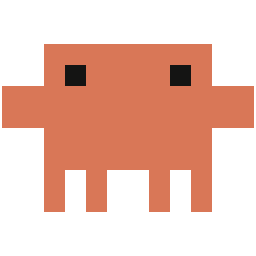

# Clawd Desktop

Clawd, the pixel crab from claude.dev, walks along the top edges of your windows and the taskbar on Windows. He lives in transparent, topmost overlay windows that never take focus and do not show up in Alt-Tab; only his own pixels take the mouse, and only while Clickable is on. Up to five of him can walk at once.

<p align="center"></p>

## What it looks like

- **Surfaces**: he walks on the visible top edge of every window and on the taskbar, turns at the ends, and rides along when you drag the window he is standing on.
- **Falling**: when that window closes, minimizes or moves out from under him, he falls to the next edge below.
- **Zero g**: now and then (about once every 20 to 30 minutes per Clawd) he plays the space act, gravity turns off for him and he floats around until it ends.
- **Company**: with more than one Clawd, each keeps his own pace and timers, and two walking into each other never pass through. When two meet head on they stop and face each other for a beat before one turns, as if chatting; now and then one climbs on the other and rides him for a moment (never three high), and rarely the one who was walking longer shoves, so the other hops over him and lands behind with a startled "?!". While Claude Code is locked in, or when one walks up to another at his laptop, they sit down with their laptops back to back or facing each other. A chat or a ride leaves him happy, a shove annoyed, and that leans his next act. None of it lasts more than about three seconds, apart from the laptops, which are ordinary laptop acts.

He hides while a fullscreen app is in front.

## What makes him do things

- **Time**: every 8 to 20 seconds of walking he stops for one of claude.dev's acts (one time in four, two in a row), or rides along the taskbar.
- **Away**: after two minutes without input he picks a rest act and keeps at it until you are back.
- **New windows**: a terminal makes the nearest Clawd have a coffee or open his laptop, a browser gives him a lightbulb, an Explorer window his notebook.
- **Focus**: switching windows makes one Clawd turn or look around.
- **Windows going away**: closing or minimizing the window he stands on drops him to the next edge below.
- **Leans** (tilt the usual pick, never force it): media playing leans toward headphones and dancing, under 20 percent battery toward a snooze, 7 to 10 am toward coffee, 1 to 4 pm toward sunglasses, 11 pm to 6 am toward a snooze.
- **Claude Code** (with [clawd-buddy](https://github.com/lperezmo/clawd-buddy) 1.12 or later): while a session is locked in he leans toward the laptop, desktop, notebook, phone, thinking and coffee; while chill, toward the idle acts; when one celebrates, every Clawd celebrates at once and hops.
- **You**: click him for an act, double click to celebrate, drag to pick him up (he drops onto the nearest edge below when you let go), right click for the tray menu with Float on top, which sends that Clawd up for the space act in zero g.
- **Perform**: the tray item, Ctrl+Alt+C or `--perform` makes every Clawd play an act now.

Reactions are over in about three seconds (a laptop or desktop session in under ten) and never interrupt a fall or a drag.

## Install

Download `Clawd-Desktop-X.Y.Z.exe` from Releases. Either just run it, or run it once with `--install`:

```
Clawd-Desktop-X.Y.Z.exe --install
```

That copies it to `%LOCALAPPDATA%\Programs\clawd-desktop\clawd-desktop.exe` and puts a Clawd shortcut on the desktop. Start with Windows in the tray menu then launches the installed copy. `--uninstall` removes the copy and both shortcuts.

## Tray menu

- Perform (Ctrl+Alt+C)
- Pause / Resume
- Clawds: 1 to 5
- Scale: 2x, 3x, 4x, 6x
- Clickable (on by default): off, the mouse goes straight through him as before.
- Follow Claude Code (on by default): reads `%LOCALAPPDATA%\clawd\sessions`, which clawd-buddy writes; nothing happens if it does not exist.
- Crowd antics (on by default, `crowd_antics` in config.toml): off, Clawds that meet only turn apart.
- Hide while fullscreen (on by default)
- Start with Windows
- Quit

Settings are saved in `%APPDATA%\clawd-desktop\config.toml`.

## Flags

- `--install`: copy the exe to the install folder and make the desktop shortcut.
- `--uninstall`: remove the installed copy, the desktop shortcut and the Startup shortcut.
- `--scale N`: screen pixels per sprite pixel (default 4, or the saved setting). Not saved.
- `--console`: log to the parent console (or a new one) and to `%APPDATA%\clawd-desktop\clawd-desktop.log`.
- `--run-for SECS`: quit cleanly after that many seconds.
- `--perform`: tell the running copy to Perform, for a shortcut or another program; with none running, start and Perform.

Only one copy runs at a time.

## Build from source

Needs the stable Rust toolchain (MSVC).

```
cargo build --release
cargo test
```

The sprite tables in `src/sprites_data.rs` are generated from clawd-buddy's `hooks/sprites.ts` and committed. To regenerate them, and the icon from them:

```
bun tools/gen-sprites.ts --repo <clawd-buddy path> --ref <branch>
cargo run --example make-icon
```

## How it works

- One small layered window per Clawd per monitor, sized to his current frame and moved with each update.
- Surfaces come from `DWMWA_EXTENDED_FRAME_BOUNDS`, so edges match what you see, not the invisible resize borders.
- Frames are pushed with `UpdateLayeredWindow` at 12 fps, and only when the frame or position changed.
- With Clickable on, each overlay drops `WS_EX_TRANSPARENT` and its window region is set to the opaque pixels of the frame it shows, so the rest of the window passes the mouse through.
- Window events (create, show, uncloak, foreground) drive the reactions; the Claude Code folder is watched with a change notification. Media is checked every 5 seconds, the clock and battery once a minute.
- `GetLastInputInfo` tells him when you have been away for two minutes.
- Settings live in `%APPDATA%\clawd-desktop\config.toml`.

## License and credits

The code is MIT, see [LICENSE](LICENSE). Clawd and his sprites are Anthropic's, from https://claude.dev, and are not covered by that license; see [NOTICE](NOTICE).
